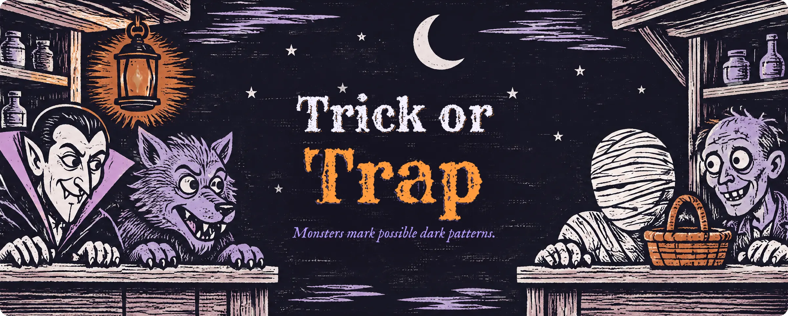
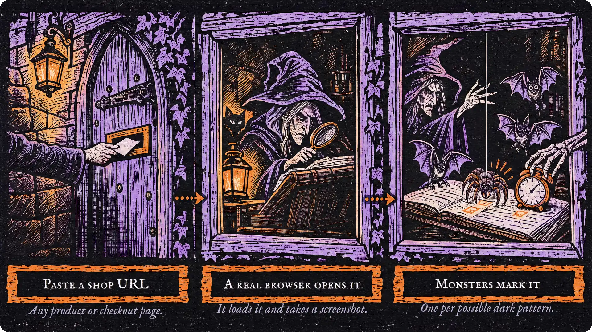
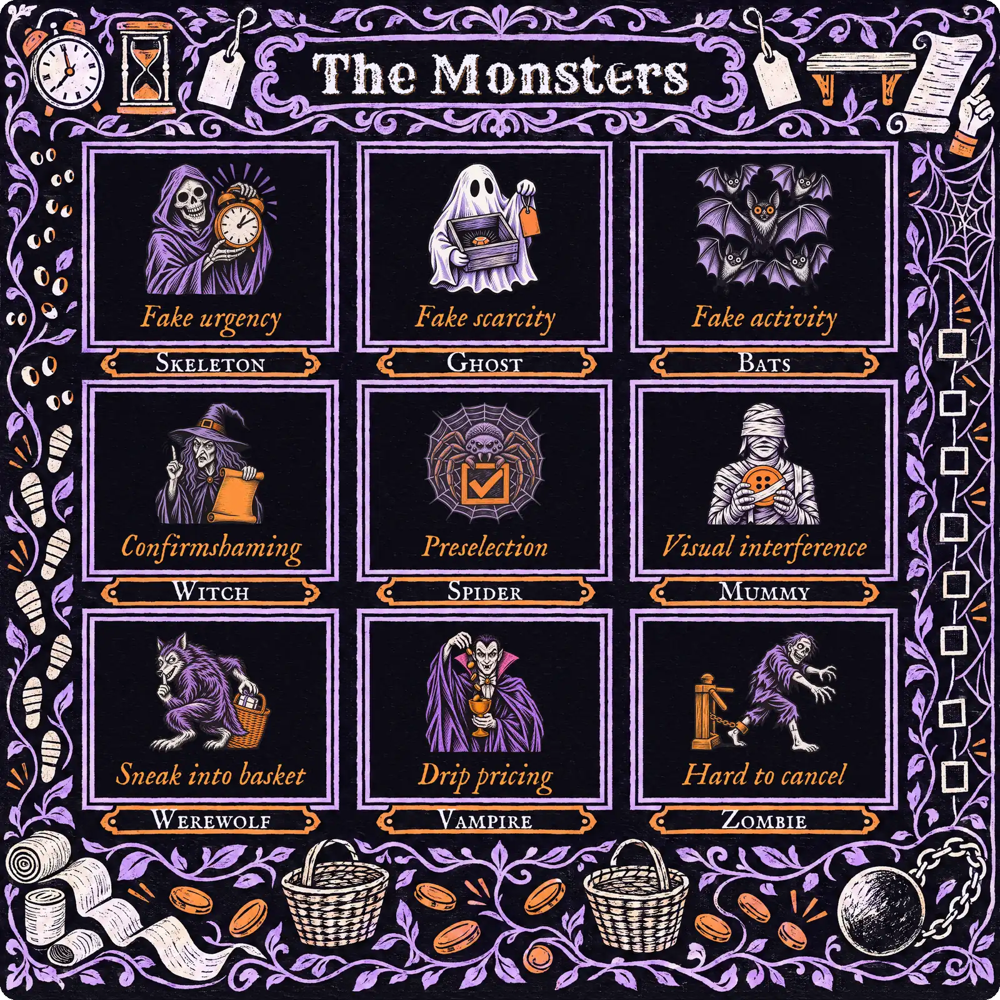
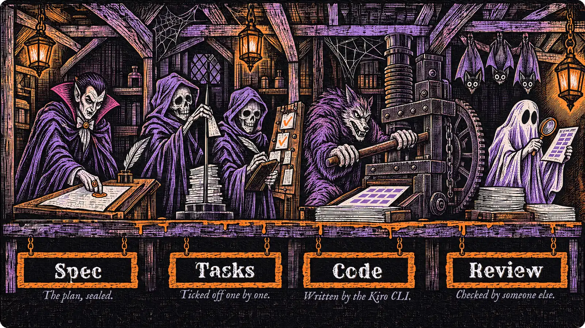

<p align="center">
  
</p>

# Trick or Trap

Paste an online shop URL. The page is meant to open in a real browser, with possible manipulative design patterns marked by monsters. Today the capture and the detectors exist; the interface does not (see [Status](#status)). Built for Kiroween 2026 with Kiro.

[](https://github.com/SelcukOzbilgi/trick-or-trap/actions/workflows/ci.yml)
**[MIT licence](LICENSE)**

## What it does

<p align="center">
  
</p>

1. You paste a shop URL.
2. A real browser opens it and takes a screenshot.
3. A monster marks each possible pattern, with the evidence and a confidence level.

There are no accounts or payments, no shop rankings, no scanning of pages behind a login, and no browser extension. These are the non-goals in `.kiro/steering/product.md`.

## Status

Nothing is deployed yet. This is what is on `main` today.

**Works today:**

- The demo shop "The Boo-tique", served under `/boo-tique` by the same Next.js app. It holds planted dark patterns and honest look-alikes, recorded in a ground-truth fixture (`tests/fixtures/boo-tique-ground-truth.json`).
- Page capture through a remote browser (Browser Use Cloud, driven by `playwright-core`) with a browser-level request guard (`lib/capture`).
- Six rule-based detectors (`lib/detectors`).

Not built yet: the interface ([#5](https://github.com/SelcukOzbilgi/trick-or-trap/issues/5)), the scan route ([#4](https://github.com/SelcukOzbilgi/trick-or-trap/issues/4)), the model reviewer ([#6](https://github.com/SelcukOzbilgi/trick-or-trap/issues/6)), the flow walker ([#7](https://github.com/SelcukOzbilgi/trick-or-trap/issues/7)), abuse guards ([#8](https://github.com/SelcukOzbilgi/trick-or-trap/issues/8)); capture and detector follow-ups in [#3](https://github.com/SelcukOzbilgi/trick-or-trap/issues/3), [#15](https://github.com/SelcukOzbilgi/trick-or-trap/issues/15) and [#17](https://github.com/SelcukOzbilgi/trick-or-trap/issues/17). The first release is tracked in [#9](https://github.com/SelcukOzbilgi/trick-or-trap/issues/9). Nothing is deployed, and no public route calls the capture module or the detectors yet; the landing page (`app/page.tsx`) is a placeholder.

## The monsters

<p align="center">
  
</p>

| Monster | Pattern | What it looks like on a page | Detector today |
|---|---|---|---|
| Skeleton | fake urgency (`fake-urgency`) | A countdown or deadline that is not real | yes |
| Ghost | fake scarcity (`fake-scarcity`) | A "low stock" or "selling fast" claim with nothing behind it | yes |
| Bats | fake activity (`fake-activity`) | Made-up claims about other shoppers, such as "people are viewing this" | yes |
| Witch | confirmshaming (`confirmshaming`) | A decline button worded to make you feel bad | yes |
| Spider | preselection (`preselection`) | A paid option that is already ticked or switched on | yes |
| Mummy | visual interference (`visual-interference`) | The choice the shop wants is loud, the other one is small and pale | yes |
| Werewolf | sneaking into the basket (`sneak-into-basket`) | An item in the cart that you did not add | planned |
| Vampire | drip pricing (`drip-pricing`) | Fees that appear late in checkout | planned |
| Zombie | hard to cancel (`hard-to-cancel`) | One click to sign up, a maze to cancel | planned |

The last three are flow patterns. A flow walker is meant to find them, on the demo shop only and never on a third-party site ([#7](https://github.com/SelcukOzbilgi/trick-or-trap/issues/7)). The demo shop has only their end states today: an "Insurance" row in the cart that you did not add, "Handling" and "Haunting fee" rows in checkout, and a membership page that says "To cancel, call us during opening hours." The steps that lead there are not built, and the ground-truth fixture marks these three entries as not scored by the static detectors.

## How it was built with Kiro

<p align="center">
  
</p>

### Specs

`.kiro/specs/` holds `requirements.md`, `design.md` and `tasks.md` for each spec. Every `-fixes` spec (including `page-capture-fixes-2`), and `boo-tique-polish`, answers an independent review of the work before it.

| Spec | What it covers | Pull request |
|---|---|---|
| [`foundation`](.kiro/specs/foundation/) | Next.js scaffold, Vitest, shared zod types, detector interface and registry | committed directly to `main` |
| [`foundation-fixes`](.kiro/specs/foundation-fixes/) | Registry factory, named detector registration, errors reported per detector | committed directly to `main` |
| [`boo-tique-static`](.kiro/specs/boo-tique-static/) | The static pages of the demo shop, the ground-truth fixture and tests that prove each entry is planted | committed directly to `main` |
| [`boo-tique-polish`](.kiro/specs/boo-tique-polish/) | 16 problems from a review of the demo shop pages | committed directly to `main` |
| [`page-capture`](.kiro/specs/page-capture/) | URL and address checks, remote browser session, element snapshot, screenshots | [#13](https://github.com/SelcukOzbilgi/trick-or-trap/pull/13) |
| [`page-capture-fixes`](.kiro/specs/page-capture-fixes/) | Answers the first security review: redirect hops and sub-resources go through the request guard, the snapshot is bounded, the collector runs in an isolated world, orphan sessions are stopped | [#13](https://github.com/SelcukOzbilgi/trick-or-trap/pull/13) |
| [`page-capture-fixes-2`](.kiro/specs/page-capture-fixes-2/) | Browser-level guard, fail closed on guard loss, service-worker refusal, collector safe against DOM clobbering | [#14](https://github.com/SelcukOzbilgi/trick-or-trap/pull/14) |
| [`detectors-static`](.kiro/specs/detectors-static/) | Six detectors, English and Turkish word lists, evaluation against the ground truth | [#16](https://github.com/SelcukOzbilgi/trick-or-trap/pull/16) |
| [`detectors-static-fixes`](.kiro/specs/detectors-static-fixes/) | Common phrases restored, generality rule and phrase corpus, hold-out evaluation, error channel | [#16](https://github.com/SelcukOzbilgi/trick-or-trap/pull/16) |

"Committed directly to `main`" means before the pull request flow was in use. As `.kiro/steering/workflow.md` says, the flow is one spec, one branch and one pull request, one commit per task, the spec's own commit first so the pull request shows the spec before the code, and merge commits, never squashed.

### Steering

`.kiro/steering/` holds the rules Kiro reads: seven files on every run, `design.md` only when Kiro edits UI files.

| File | What it fixes |
|---|---|
| `product.md` | What the product is, the nine patterns and their monsters, the two phases, the non-goals |
| `structure.md` | Folder layout and naming conventions |
| `tech.md` | Stack, the browser seam, capture rules, detector rules, abuse protections, secrets |
| `design.md` | The dark "Night Shift Field Guide" look, marker design, accessibility checklist |
| `findings-wording.md` | "Possible" titles, evidence, confidence rubric, result page rules |
| `specs.md` | The format of requirements, design and tasks files |
| `testing-and-commands.md` | Test-first rule, ground-truth coverage, machine load limits |
| `workflow.md` | One spec, one branch, one pull request, and the paths Kiro may not write |

### Builder agent profile

`.kiro/agents/builder.json` limits what Kiro can do in this repository. It may read and write files inside the repository, except `.env` files (`.env.example` is allowed). It may not write `.kiro/agents/`, `.kiro/hooks/`, `.kiro/settings/`, `.git/`, `.gitattributes`, `.npmrc`, `.githooks/`, `.github/`, `scripts/enable-hooks.mjs`, `scripts/kiro-related-tests.mjs`, `.gitleaks.toml` or `SECURITY.md`. Its shell is limited to an allow list (`npm install`, `npm ci`, `npm run`, `npm test`, a few `npx` tools and `node --test`); dev servers, watch mode and command chaining are excluded. The file says it is not a hard sandbox, because allowed npm and npx commands can run arbitrary code.

### Hook

`.kiro/hooks/test-on-save.json` has the trigger `PostFileSave`. When Kiro saves a `.ts` or `.tsx` file under `lib/` or `components/`, `scripts/kiro-related-tests.mjs` runs only the vitest files that import it. If more than 8 test files are affected, it skips the run with one line.

The hook was written against Kiro's hook documentation and loader (pull request [#11](https://github.com/SelcukOzbilgi/trick-or-trap/pull/11)). It has been seen firing once: on 2026-11-21, during the first task of the model-judge spec, on a branch not yet merged, Kiro ran it five times ("Run related tests after a source save"), and each run completed.

## Who made what

- Product code, tests and specs: written by the Kiro CLI, driven by prompts from a Claude agent. Steering: the steering files were written by the Kiro CLI on 2026-11-15, except `.kiro/steering/workflow.md`, which a Claude agent wrote. Commit bodies name the author and model for most of the work from 17 November on (`claude-sonnet-5.5` for the implementation, `claude-opus-5.5` for one spec); earlier commits often have no body.
- Repository infrastructure (CI workflow, issue and pull request templates, the hook script, the secret-scanning rules, `SECURITY.md`) and the workflow steering file: written by a Claude agent; the commit bodies from that work say so. The builder profile denies Kiro writing every one of these paths except the steering file, which is a convention.
- Research and review notes under `docs/research/`: written by Claude agents. The earliest notes were prepared before implementation, and `docs/research/README.md` says they were not written by Kiro.
- Independent reviews, including runs against the real remote browser: done by a separate Claude agent.
- Artwork: generated with an image model and prepared by a Claude agent (cropping, resizing, conversion). The lettering on the README images was set by script. Details and licence are in `docs/assets/README.md`.
- Direction and approval: the owner chose the direction and approved each image.

## What we measured

| Test | Result | What it means |
|---|---|---|
| Demo shop, planted patterns | 18 of 19 found | Regression test on the shop the rules were developed against. The one miss is the club timer (`club-timer-session-restart`). |
| Demo shop, honest look-alikes | 0 of 8 flagged | Same caveat. It says little about other shops. |
| Hold-out of the first review's probes, flag cases | 26 of 28 found | The fixes were written against these exact cases. A regression figure, not an accuracy figure. |
| Hold-out, honest cases | 1 of 20 flagged | Same caveat. |
| Independent stress probe of 50 new cases, flag cases | 12 of 30 found | The cases lean on wording outside the word lists. A stress probe, not a recall estimate. |
| Independent stress probe, honest cases | 3 of 20 flagged | Same probe. |

Figures from the run recorded in `.kiro/specs/detectors-static-fixes/design.md` (2026-11-19) and in pull request [#16](https://github.com/SelcukOzbilgi/trick-or-trap/pull/16). The tests enforce floors, not these exact counts. The 50-case stress probe is described in the spec and steering text (`.kiro/specs/detectors-static-fixes/design.md`, `.kiro/steering/tech.md`); its cases are not in the repository.

The demo shop has 22 planted entries in total: 19 for the six detectors and 3 flow patterns that the detectors do not cover. The demo-shop figures are scored on snapshots built by a test harness (`tests/detectors/eval/`), not on live captures. Matching by listed phrases does not generalise well yet, which is why a model reviewer ([#6](https://github.com/SelcukOzbilgi/trick-or-trap/issues/6)) and a generalisation round with a frozen independent evaluation set ([#17](https://github.com/SelcukOzbilgi/trick-or-trap/issues/17)) are next.

CI at the merge of pull request #16 passed 4,220 tests (8 skipped) in 92 files (1 skipped). This is the figure from that pull request's description, not a promise for today.

<details>
<summary>Known gaps</summary>

From the pull requests [#13](https://github.com/SelcukOzbilgi/trick-or-trap/pull/13), [#14](https://github.com/SelcukOzbilgi/trick-or-trap/pull/14) and [#16](https://github.com/SelcukOzbilgi/trick-or-trap/pull/16):

- WebSocket hardening misses some worker scripts: a worker script served with a content type the rewrite does not match could still open a WebSocket.
- A failed session stop is not retried. It is reported as a warning.
- Tiled screenshots stop at 10 tiles, and on pages with smooth scrolling the tile loop can stop early.
- The remote-browser tests that use the fixture pages have not run, and the fixture pages are not deployed anywhere.
- Outside what the guard can see: WebTransport, WebRTC, preconnect and DNS rebinding.
- A known false positive: an honest dark cookie banner on an uncaptured dark wrapper gets a medium visual-interference finding. Claims split across elements are missed until capture joins text ([#3](https://github.com/SelcukOzbilgi/trick-or-trap/issues/3)).

</details>

## How it works

```
 1. Request                          (planned: public scan route, #4)
 2. URL and address checks           built  lib/capture/url-check.ts, ip-ranges.ts
 3. Remote browser capture           built  lib/capture
      under a browser-level request guard
 4. Detectors over the snapshot      built  lib/detectors
 5. Model reviewer                   (planned: #6)
 6. Results page with monsters       (planned: #5, #8)
```

What is built, as `lib/capture` does it:

- The URL is checked before any browser exists: syntax, no credentials, ports 80 and 443 only, no local host names, and no private, loopback, link-local or similar addresses, with the host name resolved by DNS (`url-check.ts`, `ip-ranges.ts`).
- The remote browser runs under a browser-level request guard. It pauses and checks every request of every target (the page, frames, workers and popups), including each redirect hop.
- If the guard is lost, the capture fails closed: the session is stopped and no snapshot or image is returned. The public outcome for a failed scan is "could not scan", never clean (an outcome type in `lib/capture`; no page shows it yet).
- A successful capture returns an element snapshot with boxes and styles, screenshots, and a second sample taken after a reload. The overall capture deadline is 45 seconds.
- Detectors are pure functions over that snapshot. Each returns findings. A detector that throws is reported as an error and never turns into "no finding".
- Page text in a snapshot is untrusted data for every consumer, including the planned model reviewer.

`docs/research/architecture.md` holds the pre-implementation research. It was not written by Kiro.

## Where things are

```
app/            Next.js routes: placeholder landing page, the Boo-tique (/boo-tique), test-only capture fixture routes
components/     React components of the Boo-tique
lib/
  boo-tique/        content, styles, variants and the ground-truth schema of the demo shop
  capture/          page capture: URL checks, remote browser, request guard, collector, screenshots
  capture-fixture/  builders for the test-only fixture pages
  detectors/        the six detectors, shared helpers and word lists
  types/            zod schemas and types (PageSnapshot, Finding)
tests/          unit tests, fixtures (ground truth, phrase corpus, snapshots) and the detector evaluation
public/         artwork: monsters, hero and spot art, Boo-tique product photos
.kiro/          specs, steering, the builder agent profile, the save hook
docs/           research/ (pre-implementation notes, later review and spike notes), images/ (README images), assets/ (artwork provenance)
scripts/        enable-hooks.mjs and kiro-related-tests.mjs
.github/        CI workflow, issue and pull request templates, dependabot config (.githooks/: optional pre-commit secret scan)
```

## Run locally

Node 20.9 or newer is required (`engines` in `package.json`).

```sh
npm install        # or: npm ci
npm run dev        # development server; the demo shop is at /boo-tique
npm test           # unit tests, run once, two workers
npm run typecheck  # tsc --noEmit
npm run lint       # ESLint
npm run build      # production build; downloads Google Fonts, so it needs network access
npm run hooks:enable   # optional pre-commit secret scan, see below
```

<details>
<summary>Environment variables (names only)</summary>

Names as listed in `.env.example`. Set them in your shell or in a local env file that you never commit.

Read by page capture today (`lib/capture/config.ts`):

| Name | Meaning |
|---|---|
| `BROWSER_USE_API_KEY` | Browser Use Cloud key. Required when the browser mode is `remote`. |
| `BROWSER_USE_PROXY` | `on` or `off`. Default `off`. |
| `BROWSER_USE_SESSION_TIMEOUT_MINUTES` | Whole number from 1 to 5. Default 1. |
| `CAPTURE_BROWSER_MODE` | Default `remote`. Only `remote` is implemented. |
| `CAPTURE_WEBSOCKET_HARDENING` | `on` or `off`. Default `on`. |

Test-only fixture switches:

| Name | Meaning |
|---|---|
| `CAPTURE_FIXTURE_ROUTES` | The routes under `/capture-fixture` answer only when this is exactly `on`. Keep it off in production. |
| `CAPTURE_FIXTURE_ALT_ORIGIN` | An `https` origin that the fixture page embeds as its cross-site frame. Optional. |
| `LIVE_FIXTURE_BASE_URL` | Remote-browser test only: origin of a deployment that serves the fixture routes. |
| `LIVE_FIXTURE_ALT_BASE_URL` | Remote-browser test only: the same deployment on another site. |

Listed for later features (no code reads them yet): `SUPABASE_URL`, `SUPABASE_ANON_KEY`, `SUPABASE_SERVICE_ROLE_KEY`, `ANTHROPIC_API_KEY`, `GEMINI_API_KEY`.

`NEXT_PUBLIC_APP_URL` is parsed by `lib/capture/config.ts` but not used yet. It is meant for the app's public origin (absolute links, `og:` tags) and it bypasses no capture check. The opt-in remote-browser test reads it to find a running Boo-tique.

The remote-browser capture test (`tests/capture/remote-capture.test.ts`) is opt-in. It is skipped unless `RUN_REMOTE_CAPTURE=1` and a Browser Use API key are set.

</details>

<details>
<summary>Optional secret scan before commits</summary>

Every push to `main` and every pull request is scanned for secrets in CI. To also scan staged changes on your own machine, run `npm run hooks:enable` once. It sets `core.hooksPath` to `.githooks` for this checkout only. The hook runs `gitleaks` over staged changes if the binary is on your PATH. Without `gitleaks` on your PATH the hook lets the commit through. To turn it off, run `git config --unset core.hooksPath`. See `SECURITY.md`.

</details>

## Safety and wording

- Every finding is titled "Possible ...", states the on-page evidence, and gives a confidence level (high, medium or low) as a word. Every result must carry the line "Automated detection — may be wrong." and a scan date. These rules are in `.kiro/steering/findings-wording.md`.
- Findings describe what is on the screen. They do not state intent and do not make legal judgements. A list of forbidden words is masked by stem, and `tests/detectors/wording.test.ts` checks that no finding string holds a forbidden word, that every title starts with "Possible" and that quoted page text is masked.
- Results pages are meant to be non-indexable. That is a steering rule. The results page is not built yet ([#5](https://github.com/SelcukOzbilgi/trick-or-trap/issues/5), [#8](https://github.com/SelcukOzbilgi/trick-or-trap/issues/8)). The demo shop already sets `robots` to no-index.
- Removal requests: there is no contact address in the repository and no removal route is built yet ([#8](https://github.com/SelcukOzbilgi/trick-or-trap/issues/8)). Security reports go through `SECURITY.md`.

## Security and licence

Report security problems privately through the repository's Security tab, as [`SECURITY.md`](SECURITY.md) describes. There is no security email address.

The code is under the MIT licence: see [`LICENSE`](LICENSE). The artwork is published under the same licence. Its provenance, and the terms of the image model and API, are in [`docs/assets/README.md`](docs/assets/README.md).
